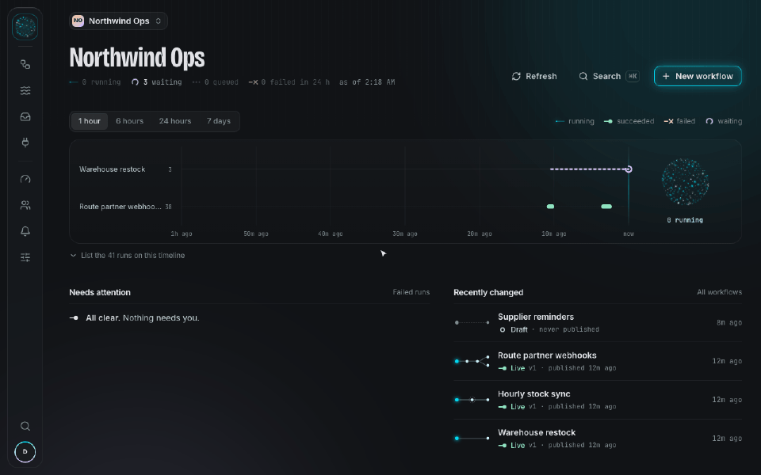
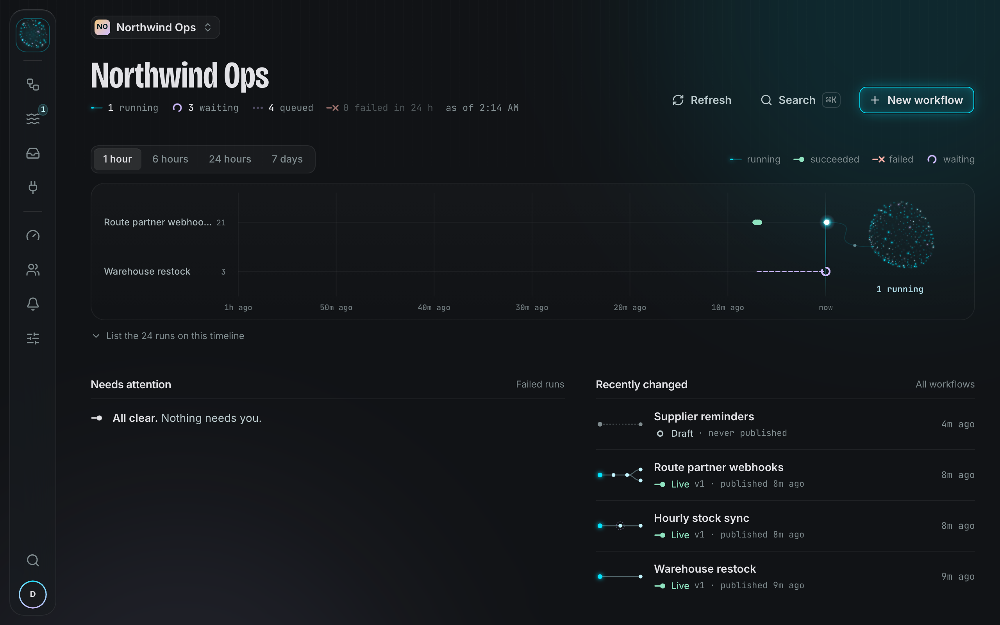
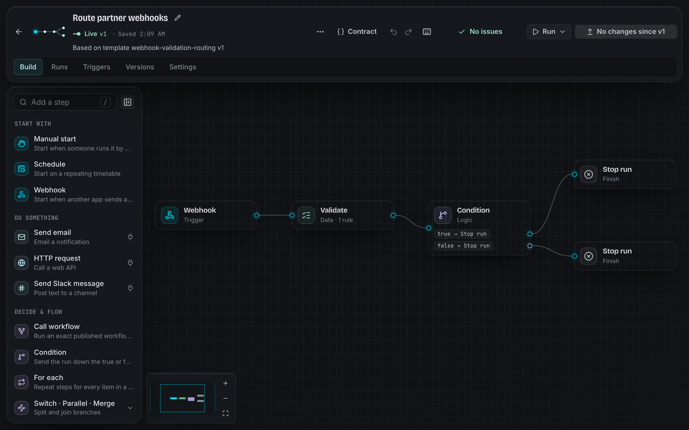
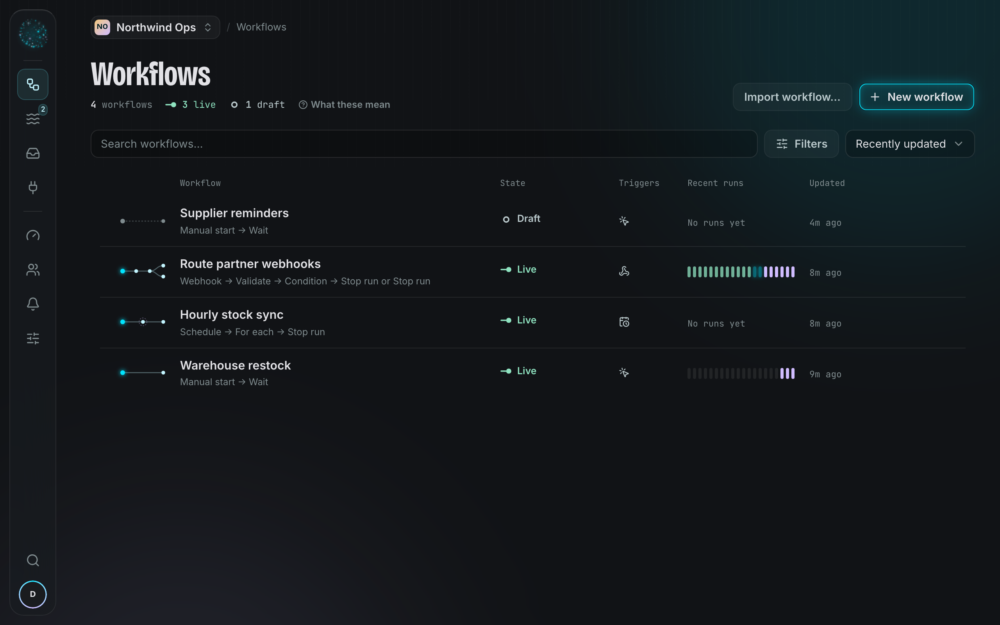
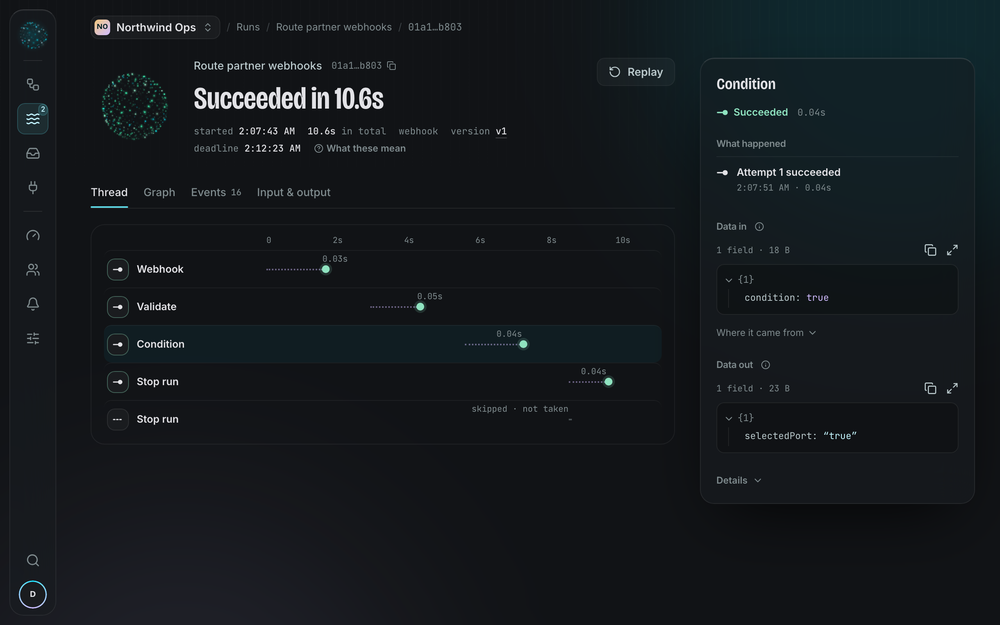

# Pertexo

Pertexo is a workflow automation platform for teams that need their automations
to keep working: runs survive crashes and restarts, a call that may already have
reached another system is never blindly repeated, and every workspace is
isolated down to the database row. It is built from scratch as a TypeScript
monorepo with its own execution engine, API, worker and web app.



## Highlights

- **Durable execution.** PostgreSQL is the source of truth for every run,
  checkpoint and wait. Steps run as leased attempts dispatched through a
  transactional outbox: a crashed worker's attempt is reclaimed, and one that
  may already have had an effect is marked as uncertain instead of retried.
- **Safe publishing.** Workflows are edited as drafts and published as immutable
  versions. Runs stay pinned to the version they started on, and reusable
  subworkflows call an exact published version.
- **Try it before it's live.** Test a single step from the editor, save named
  inputs for real runs that warn about their effects first, and see exactly what
  an imported file contains before anything runs.
- **Guardrails built in.** Workspace capacity and per-workflow concurrency
  limits, automatic pausing of workflows that keep failing, connection health
  checks and a failure inbox.
- **Secure by default.** Row-level security scopes every query to one workspace.
  Connection credentials are envelope-encrypted with a managed key, webhooks are
  signed and five roles decide who can do what.
- **Work together.** Discuss workflows and steps, mention teammates privately,
  and see advisory viewing/editing presence while draft revision checks keep
  concurrent saves safe. See [collaboration](docs/guides/collaboration.md).
- **Weft, its own design language.** Runs are threads, outcomes are knots and
  live work glows. The interface reads like the work it shows.

| Workspace home                                                                                     | Workflow editor                                                                                   |
| -------------------------------------------------------------------------------------------------- | ------------------------------------------------------------------------------------------------- |
|         |  |
| **Workflows**                                                                                      | **One run**                                                                                       |
|  |    |

## Architecture


PostgreSQL is authoritative for workflows, runs, waits, and execution state.
Redis and BullMQ provide immediate transport and coordination but are treated as
rebuildable infrastructure. Queue messages carry identifiers rather than graphs,
credentials, or large payloads.

```text
apps/
  web/                 React/Vite product application
  api/                 NestJS control-plane API
  worker/              coordination, node attempts, previews, triggers,
                       retention, and workspace deletion
  ops/                 audited operator commands

packages/
  database/         PostgreSQL persistence, roles, and migrations
  workflow-model/   graph, JSON, portability and expression policy
  workflow-engine/  pure execution state machine
  execution/        run orchestration and attempt input projection
  node-sdk/          node definition and executor contracts
  nodes-core/        built-in deterministic nodes
  node-catalog/      registry of every node definition and executor
  templates/        curated workflow content
  integrations/     provider and credential boundaries
  queue/             BullMQ transport and Redis event hints
  artifact-store/    bounded object storage
  rate-limit/        distributed abuse-limit policy and atomic counters
  contracts/         public API schemas and generated artifacts
  observability/     logging, tracing, and metrics
```

[The architecture map](./docs/architecture.md) describes the current seams.
Decisions are recorded as [ADRs](./docs/adr);
[ADR 069](./docs/adr/069-architecture-reset.md) takes precedence over superseded
ones, and [CONTEXT.md](./CONTEXT.md) is the glossary.

## Stack

- TypeScript and pnpm workspaces
- React, Vite, TanStack Router/Query, Tailwind and Base UI for the web app
- NestJS API with separately deployable workers
- PostgreSQL with explicit SQL and row-level security
- Redis and BullMQ
- Zod contracts with generated OpenAPI descriptions
- OpenTelemetry and structured logging
- S3-compatible object storage
- Vitest, Playwright, and integration tests against real PostgreSQL, Redis and
  S3-compatible services

## Local Development

Prerequisites: Node.js 24, pnpm 11, Docker, and Docker Compose.

```bash
pnpm install
pnpm dev
```

`pnpm dev` creates `.env` from `.env.example` when it is missing, starts
Postgres, Redis and the local object store, builds the workspace, migrates the
database, and runs the API, worker and web app with prefixed logs. It seeds a
verified development account. Open `http://127.0.0.1:5173` and sign in with the
development credentials printed by `pnpm dev` after setup. Stop everything with
Ctrl+C; services keep their data until `docker compose down -v`.

- The example environment is for local development only; do not commit
  credentials or production configuration.
- Local authentication mail is never sent: the API prints each verification or
  reset link to its log.
- Connections, Alerts and webhooks use `CONNECTION_ENCRYPTION_MODE=local` and
  `CONNECTION_LOCAL_KEY` from the example. The key must encode 32 bytes and stay
  stable across API and worker restarts; changing it makes existing local
  connection and webhook secrets unreadable. The example key is public and meant
  only for disposable development credentials. Staging and production refuse
  local mode and require `CONNECTION_KMS_KEY_REFERENCE` and
  `CONNECTION_KMS_REGION` instead. Existing `.env` files are not overwritten;
  add the two local settings from `.env.example` to enable them.
- Without invitation token protection, Team disables Invite and resend with a
  configuration reason, and sending commands return a typed 503. Invitation
  emails wait for their separate delivery configuration.
- Local connection encryption does not simulate providers: tests and alert
  delivery still call the configured service.

To run one process on its own, load `.env` into the shell first
(`set -a; . ./.env; set +a`) and use `pnpm dev:api`, `pnpm dev:worker` or
`pnpm dev:web`. Workspace packages resolve their compiled `dist` exports: after
changing a shared package, run `pnpm build` and restart the affected process.

Common commands:

```bash
pnpm dev
pnpm check
pnpm test
pnpm test:integration
pnpm test:e2e
pnpm db:migrate
pnpm db:generate
```

`pnpm check` runs formatting, build, lint, typecheck, unused-code detection,
generated-contract drift, the schema check and package-boundary checks.
`pnpm test` runs the unit tests. `pnpm test:integration` needs the local
PostgreSQL, Redis and S3-compatible services above. `pnpm test:e2e` runs the
browser tests against the mocked API.

`pnpm db:generate` generates incremental SQL from the Drizzle schema and its
tracked snapshot. Retained SQL exceptions are documented in the architecture
map. `pnpm db:migrate` applies the migration history. Databases from before the
final reset baseline must be recreated; the runner refuses the old history.

`pnpm install` configures the pre-push hook. Every push runs `pnpm prepush`:
formatting, typecheck, and lint for the packages changed since `origin/main`; a
docs-only push checks formatting alone. CI runs everything on the pull request,
except that a docs-only pull request skips the heavy jobs.

## Deployment

A private beta runs on one server with Docker Compose, deployed from GitHub
after CI passes, with nightly off-server backups.
[ADR 071](./docs/adr/071-single-server-beta.md) records that choice and the
[runbook](./docs/operations/single-server.md) covers setup, deploys, rollback
and restore. Paid hosting targets AWS, as recorded in
[ADR 015](./docs/adr/015-production-slo-region-and-recovery.md) and
[ADR 028](./docs/adr/028-ecs-deployment-manifest.md).

## Project Status

Pertexo is a personal engineering project in active development, not a hosted
commercial service. The [product roadmap](./docs/product-roadmap.md) lists what
is built and what is planned.

## Contributing, Security, and License

Development and review expectations are in
[`CONTRIBUTING.md`](./CONTRIBUTING.md). Report vulnerabilities privately as
described in [`SECURITY.md`](./SECURITY.md).

Pertexo is available under the
[PolyForm Noncommercial License 1.0.0](./LICENSE.md). You may read, run, change
and share it for any noncommercial purpose, such as learning, personal projects
or research. Commercial use needs separate permission from the author.

System account and invitation mail can use Resend (default) or an existing SMTP
submission server with verified STARTTLS or implicit TLS. Set
`SYSTEM_MAIL_TRANSPORT=smtp` and the worker's `SYSTEM_MAIL_SMTP_*` settings;
keep the existing mail senders and encryption keys. SMTP does not require Resend
credentials. See
[system mail operations](docs/operations/single-server.md#system-mail-resend-or-smtp)
for configuration, delivery uncertainty and switching providers safely. Workflow
Email steps and workspace Alerts still use their workspace Resend connections.

Human decisions in workflows: [approvals guide](docs/guides/approvals.md).

Personal API tokens and the HTTP CLI:
[automation guide](docs/guides/automation.md).

Run a separate workflow after a failure:
[error workflow guide](docs/guides/error-workflows.md).

Published member/public forms and durable input requests:
[forms guide](docs/guides/forms.md).

Typed workspace records, CSV imports and retry-safe table steps:
[data tables guide](docs/guides/data-tables.md).

Shared non-secret configuration with immutable run snapshots:
[workspace variables guide](docs/guides/variables.md).

A personal Inbox, follow/mute and notification email schedules:
[notification guide](docs/guides/notifications.md).

Current capacity, approaching-limit warnings and retained run trends:
[usage guide](docs/guides/usage.md).

Pinned samples, whole-draft tests and saved-case suites with publish warnings:
[pinned samples guide](docs/guides/pinned-samples.md).

Call APIs with run data in the address, parsed JSON responses and safe retries:
[HTTP requests guide](docs/guides/http-requests.md). Choose total tries and
fixed waits for eligible failures in
[step retry settings](docs/guides/step-retries.md).

Receive events with Signed, Secret URL or Header secret authentication:
[webhooks guide](docs/guides/webhooks.md).

Group webhook/form business events by an input key with optional deduplication,
debounce or throttle:
[event coordination guide](docs/guides/event-coordination.md).

Reply to a waiting webhook caller:
[webhook responses](docs/guides/webhook-responses.md).

Write JavaScript transforms with the isolated [Code step](docs/guides/code.md).

Process lists with [For each](docs/guides/for-each.md) and
[Batch items](docs/guides/data-transforms.md#batching-work-for-for-each).

Workspace owners and admins can inspect and export the
[audit log](docs/guides/audit.md) and configure how long its metadata is kept.

Review and [promote workflow definitions](docs/guides/environments.md) between
linked workspaces, while keeping each environment's values, credentials and data
separate. Target publishing approval still applies.

Configure optional [Google/GitHub sign-in](docs/guides/single-sign-on.md) per
install.

Document a workflow with [canvas notes](docs/guides/canvas-notes.md): Markdown,
Weft colours and keyboard/phone editing, retained through publication and
promotion without changing execution.
