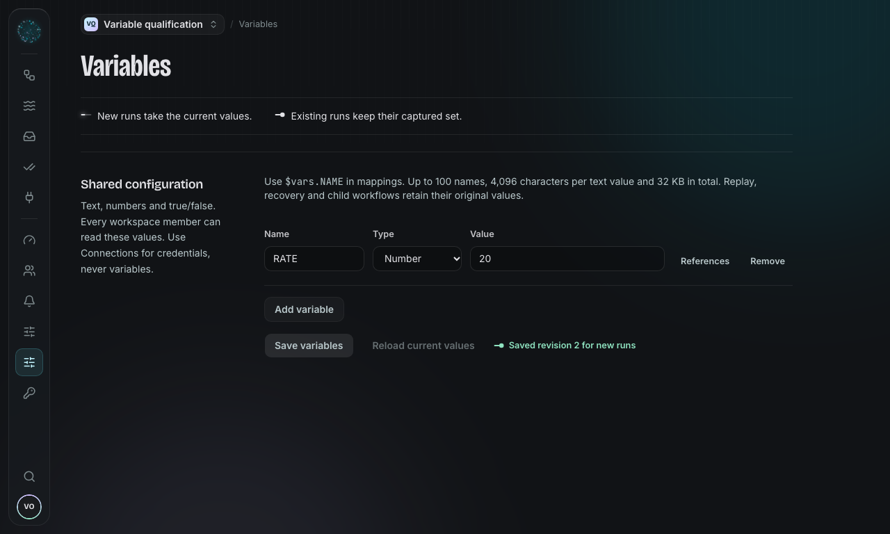
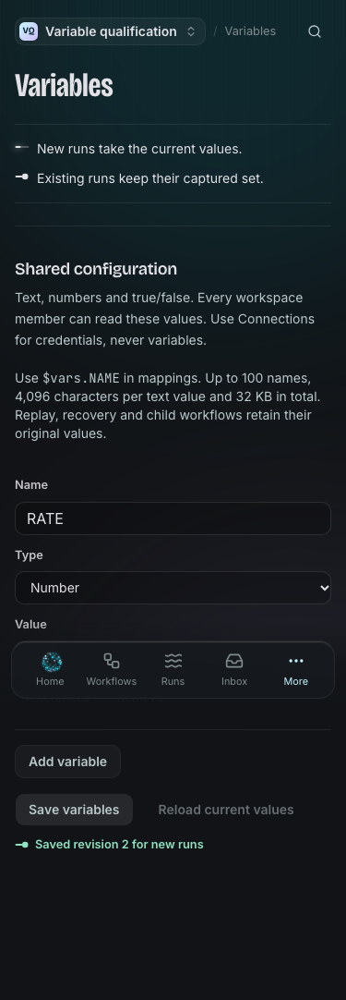
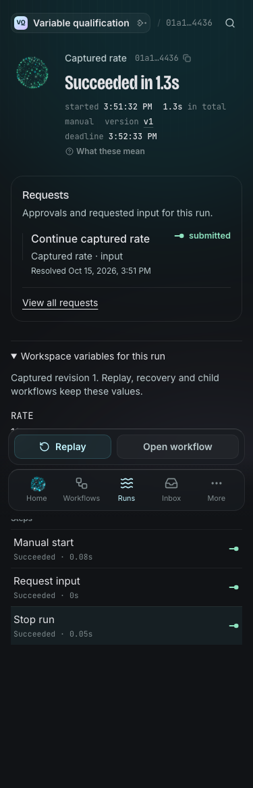
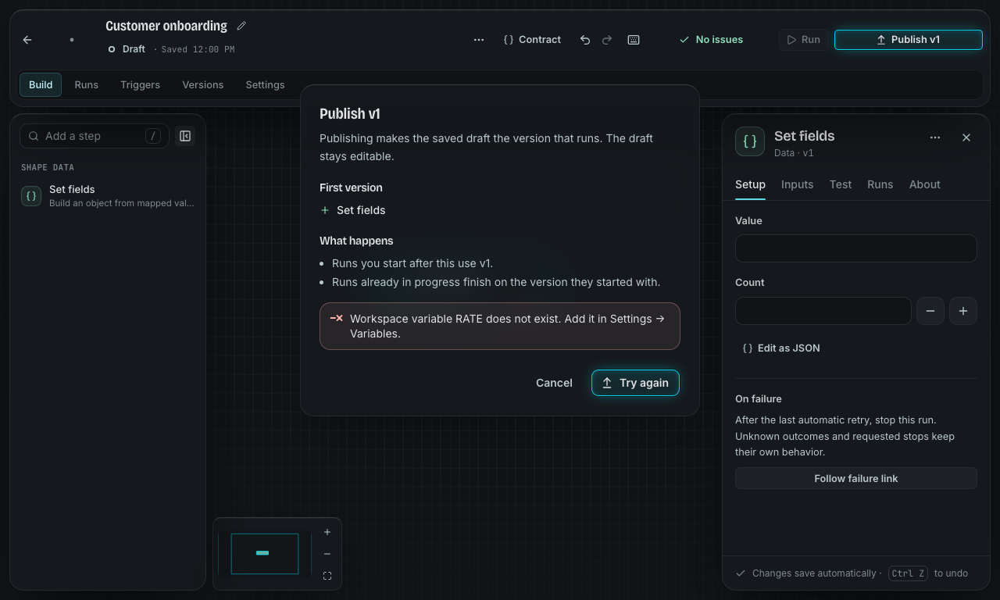
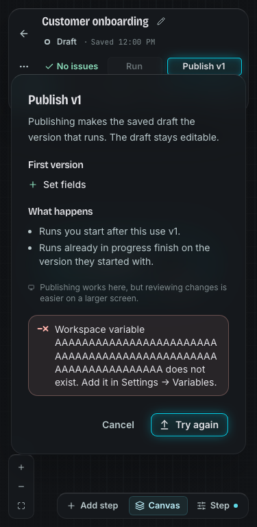

# Workspace variables

Variables hold ordinary reusable configuration for one workspace. Open **Settings
→ Variables**. Owners and admins can add, edit and remove values; every workspace
member can read them. Use **Connections** for credentials. Variables are not an
encrypted secret store and may appear in ordinary run data or mapped requests.

Choose a name such as `BASE_URL`, `CURRENCY`, `RETRY_LIMIT` or `SANDBOX`. Names use
uppercase letters, digits and underscores and begin with a letter. Values are
text, a finite number or true/false. Empty text, zero and false are valid. There
are at most 100 variables, 4,096 characters per text value and 32 KB in total.
An optional description explains each value in Settings and the mapping picker.
Descriptions are visible to every member too: at most 500 characters each and
16 KB in total, separately from the values budget. Blank descriptions are removed.
Changing a description creates a revision; it does not change execution values.

In a step's mapping, choose **Insert data → Workspace variables**, for a direct typed reference such as `$vars.CURRENCY`. On steps that
support expressions (Set, conditions, list/date transforms and Call), you can
also compute a value with JSONata:

```jsonata
$vars.BASE_URL & "/invoices"
```

```jsonata
runInput.amount * $vars.EXCHANGE_RATE
```

Computed mappings use the existing restricted JSONata policy; a direct variable
source works on every mapped input and does not need an expression worker. A variable does not substitute
itself into literal text or a step's configuration JSON. `$vars` is the only new
binding; process environment variables and credentials are unavailable.

Publishing checks that every direct variable source and required static
`$vars.NAME` exists, including loop bodies and callable results. Add missing
names in **Settings → Variables**, or change the mapping. Optional and dynamic
whole-map lookups keep the behavior described below. Removing a name later does
not rewrite an existing publication or the values captured by earlier runs.

A direct read of a missing name fails the step clearly, including a direct read
inside an `exists`/conditional guard. For an optional name, use whole-map lookup:

```jsonata
$lookup($vars, "CURRENCY") ?? "EUR"
```

If a dynamic lookup is itself the mapping result and has no match, the mapping
fails rather than silently omitting required data.

## Which values does a run use?

Each independent run captures the complete current set once when Pertexo accepts
it. The values are stored once per immutable workspace revision; runs and previews
keep a reference, rather than a second full copy. Changes apply to later independent runs. A queued run, retry, Wait, Approval
or Request input continues with its captured values. Child workflows inherit
the parent's snapshot, including nested Calls.

Full replay and retry-from-step retain the source snapshot, even if you select
another version or edit the replay input. Start a new run to use current values.
A run started by **When a workflow fails** is independent: it captures current
variables and receives only the existing safe failure summary from its source.

A step preview captures current values when the preview is accepted. Repeating
an uncertain command preserves its accepted snapshot. Run detail shows the
non-secret snapshot and revision under normal run-read access. Thirty days after completion (and after the run is no longer live), historical replay cannot recover that snapshot and
refuses instead of substituting today's values.

## Find references before changing a name

The Variables page shows references in current drafts and current publications,
including loop bodies and callable results. The check goes through every workflow
you can see by itself and shows how far it has got. Removing a name waits until it
ends, and says so if it stopped early. A direct name is exact; a computed lookup or whole-map expression may use any
variable. Literal text that happens to contain `$vars.NAME` is not a reference.
Invalid draft expressions are reported as unanalysed, not as proof of no usage.
Archived workflows are labelled; retained old versions and run snapshots are
historical records outside this current-reference list.

Removing or renaming a variable does not rewrite workflows or retained snapshots.
New runs whose expressions require that name fail clearly. Recreate the name or
update those mappings. Workflow exports carry mapping references, not the workspace's
values; imported workflows use variables from their destination workspace.

Environment-specific overrides, secret variables and editable historical variable
sets are later work.

## Screens










